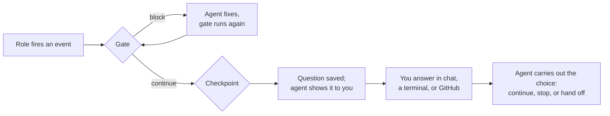

# Gates and checkpoints

Most hooks run and the role carries on. Gates and checkpoints are the two kinds
that can **stop the run** until something happens:

- A **gate** is an automated check, such as tests, lint, or a policy script. When it blocks, the agent fixes the problem and the check runs again, within a fixed number of rounds.
- A **checkpoint** is a question for you, such as *"The plan is ready. Critique it, revise it, or stop?"* The run pauses until you answer, in chat or from GitHub.
- **Rules** answer a checkpoint automatically when a condition holds, such as *"Plan Critic said ready, so implement"*. Loop limits stop automatic chains from running forever.

They are ordinary hooks in `.spec-lite/hooks.json`; read [Hooks](hooks.md)
first. You never need to run CLI commands for them to work: the roles fire
them, and you answer in chat.

- [How a pause works](#how-a-pause-works)
- [Gates](#gates)
- [Checkpoints](#checkpoints)
- [Automatic answers and loop limits](#automatic-answers-and-loop-limits)
- [Answer checkpoints from GitHub](#answer-checkpoints-from-github)
- [Notifications](#notifications)
- [Waiting and resuming](#waiting-and-resuming)
- [When something is stuck](#when-something-is-stuck)
- [Requirements and limits](#requirements-and-limits)
- [Under the hood](#under-the-hood)

## How a pause works



1. A role fires an event. Its hooks run in order: gates first, then checkpoints, then hooks that change things, such as commits, pushes, and webhooks.
2. A gate that blocks sends the agent back to fix the problem, and the gate runs again.
3. A checkpoint saves its question and returns at once. The CLI never sits waiting; the hooks after it wait until you answer.
4. The agent shows you the question and choices, then waits for your reply.
5. You answer. The agent records your answer and carries out the choice.

The saved state survives the session. If you close the agent, the question is
still there when you come back. See [Waiting and resuming](#waiting-and-resuming).

## Gates

### Write a gate

A gate is a `command` or `script` hook with `"gate": true` and
`"onFailure": "abort"`. It must be safe to run more than once, and it must not
publish or notify anything, because it runs again after every fix:

```json
{
  "version": 1,
  "hooks": [
    {
      "name": "verify",
      "events": ["implement.post"],
      "type": "script",
      "gate": true,
      "maxRounds": 3,
      "onFailure": "abort",
      "run": "node scripts/check-gate.mjs"
    }
  ]
}
```

The script reads the usual [payload](hooks.md#payload) and must write exactly
one answer to the file named by `SPEC_LITE_RESPONSE_FILE`:

```js
// scripts/check-gate.mjs
import fs from "node:fs";
import { execSync } from "node:child_process";

let answer = { decision: "continue" };
try {
  execSync("npm test", { stdio: "pipe" });
} catch {
  answer = { decision: "block", reason: "Tests fail. Fix them before finishing." };
}
fs.writeFileSync(process.env.SPEC_LITE_RESPONSE_FILE, JSON.stringify(answer));
```

| The gate… | Result |
|---|---|
| writes `{"decision": "continue"}` | Passes; the next hooks run |
| writes `{"decision": "block", "reason": "…"}` | **Blocks** (exit `3`); the agent sees the reason, fixes, and retries |
| exits non-zero, times out, writes nothing, or writes anything else | **Fails** (exit `1`); the run stops. A broken gate never counts as a pass |

The answer must be 1 byte to 64 KiB of JSON with only `decision` and an
optional `reason`. To try a gate script by hand, give it a response file
yourself:

```bash
SPEC_LITE_RESPONSE_FILE=answer.json node scripts/check-gate.mjs && cat answer.json
```

### What happens when it blocks

The agent reads the reason, fixes the problem within the current task, and runs
the **same event again**. The gate runs again, and once it passes, the hooks
after it run. Hooks that ran before the gate are not repeated, except the
changeset capture builtins, which refresh the list of changed files.

`maxRounds` (default `3`, up to `100`) counts every run of the gate, including
the first, so `3` means one check plus at most two fix-and-retry rounds. With
several gates on one event, the smallest `maxRounds` applies to all of them.

### When the rounds run out

At the limit, the agent stops and reports the block. It can't reset the count,
skip the gate, or turn the block into a warning. You decide what happens next,
and the agent runs the command the result shows:

| You say | Command | Effect |
|---|---|---|
| *"Try again"* | `spec-lite hook recover <event-id> --generation <n> --mode retry --reason "…"` | Runs the gate again now, with a fresh set of rounds |
| *"Skip the verify check this time"* | `… --mode override --checks verify --reason "…"` | The named gate is skipped for this event, recorded as an override, never as a pass |
| *"Stop"* | `… --mode stop --reason "…"` | Ends the role run; hooks that already ran stay done |

`spec-lite next` lists blocked work with the exact command, including its IDs.
`--reason` records your instruction with the recovery.

### Ordering rules

Gates run before checkpoints and before hooks that change things. The default
`order` of `15` does that. `hook validate` reports a gate ordered after such a
hook. The changeset capture builtins (order `10`) and `prepare-worktree` don't
count as changes, so a gate on `implement.post` sees the captured changeset.

## Checkpoints

### Write a checkpoint

A checkpoint is the `checkpoint` builtin, subscribed to any event, with a
question and two or more choices:

```json
{
  "version": 1,
  "hooks": [
    {
      "name": "plan-ready",
      "events": ["plan.post"],
      "type": "builtin",
      "builtin": "checkpoint",
      "options": {
        "question": "Plan ${plan.name} is ready. What next?",
        "inputs": ["${plan.file}"],
        "choices": {
          "critique": {
            "description": "Run Plan Critic",
            "skill": "plan-critic",
            "args": "${plan.file}"
          },
          "continue": {
            "description": "Finish the plan here",
            "continue": true
          },
          "stop": {
            "description": "Stop here",
            "stop": true
          }
        }
      }
    }
  ]
}
```

### Checkpoint options

<!-- builtin-options-table:checkpoint:start -->
| Option | Type | Meaning |
|---|---|---|
| `question` | string | **Required.** Text shown to the person. Supports `${...}` templates from the event. |
| `choices` | object | **Required.** Two or more answers, keyed by a lowercase-hyphenated ID such as `critique` (`ask` is reserved). Each choice continues, stops, or hands off; see Choices. |
| `attach` | string array | Files shown with the question. Fingerprinted like `inputs`, and posted into the GitHub comment when `github` is set. |
| `inputs` | string array | Files the answer depends on. They are fingerprinted when the question is asked; if one changes before the answer is used, the question must be asked again. Never published. |
| `rules` | object array | Automatic answers: `{ if, choose }` objects; see Automatic answers. |
| `github` | object | Also post the question to GitHub and accept replies there; see Answer checkpoints from GitHub. |
| `expiresIn` | string | How long the question can be answered: a number and unit (`ms`, `s`, `m`, `h`, `d`), such as `30m` or `7d`. Default: `72h`. |
| `afterEffects` | boolean | Allow the checkpoint to run after hooks that change things (a commit, a push, a webhook) on the same event. Default: `false`, so it must run before them. |
<!-- builtin-options-table:checkpoint:end -->

`choices`, `rules`, and `github` are described below. `question`, `inputs`,
`attach`, and choice `args` support `${...}` [templates](hooks.md#interpolation)
from the event.

### Choices

Each choice has a `description` and exactly one of `continue`, `stop`, `skill`,
`agent`, or `prompt`:

| Field | Meaning |
|---|---|
| `description` | **Required.** Shown next to the choice. |
| `continue: true` | Resume the role where it paused. The hooks after the checkpoint run, such as commits and pushes. |
| `stop: true` | End the role run here. Hooks that already ran are not undone. |
| `skill: "<name>"` | Hand off to that skill. The paused role ends, and **the hooks after the checkpoint on this event are cancelled**. |
| `agent: "<name>"` | The same, for an agent. |
| `prompt: "<text>"` | Hand off to a free-text instruction. Needs `completion`. |
| `args` | Arguments for `skill`, `agent`, or `prompt`. Besides event variables, it may use `${decision.choice}`, `${decision.feedbackFile}`, and the other [`decision` variables](hooks.md#interpolation). |
| `completion: "reported"` | Required for a `prompt`, and for a skill or agent that isn't a spec-lite role. The agent records the outcome with `spec-lite action complete`. |

Choice IDs are lowercase words joined by hyphens, such as `critique` or
`ship-it`; `ask` is reserved.

> **Hand-offs cancel what's left.** A checkpoint on `implement.post` runs before
> `commit-progress` and `create-pull-request`, so choosing `review` there skips
> the commit and pull request for that run. To review *after* the push, order
> the checkpoint after them (`"order": 310`) and set `"afterEffects": true`.

### What you see and how to answer

When the checkpoint fires, the role stops, and the agent shows the question and
choices and waits. For example:

```text
Plan orders is ready. What next?
  critique — Run Plan Critic
  continue — Finish the plan here
  stop     — Stop here
```

Reply in chat with the choice, and add any feedback, such as *"critique"* or
*"revise: merge features 4 and 5"*. The agent records your answer and carries
it out. Feedback is saved with the answer. To pass it to the next role, use
`${decision.feedbackFile}` in that choice's `args`.

You can also answer outside the chat, from another terminal, or from your phone
through [GitHub](#answer-checkpoints-from-github):

```bash
spec-lite next                                   # what's waiting, with IDs
spec-lite decide d-0123456789 critique           # record an answer
spec-lite decide d-0123456789 critique --feedback "focus on the data model"
```

Recording an answer doesn't start the work. The agent picks it up the next time
it checks. If its session has ended, start a new one and ask it to resume.

### When an answer no longer applies

- **A relevant file changed.** Files in `inputs` and `attach` are fingerprinted when the question is asked. If one changes before your answer is used, the answer is void, and the result says so. Re-ask with `spec-lite decision reissue <id> --reason "…"`. Unrelated edits don't affect it.
- **The question expired.** After `expiresIn` (default `72h`), it can't be answered. Re-ask it with `decision reissue`, or end the run with `spec-lite hook recover <event-id> --mode stop`.
- **You withdrew it.** `spec-lite decision cancel <id> --reason "…"` keeps the run paused until you reissue the question or stop the run.

### Ordering rules

A checkpoint must run before hooks that change things on the same event, such as
your order-`100` hooks, `commit-progress`, and webhooks. The default `order` of
`20` does that. To ask *after* them, give it a higher `order` and set
`"afterEffects": true`; the question then lists what already ran.

An event can have only one checkpoint or [hand-off hook](hooks.md#hand-offs-skill-agent-and-prompt).
Checkpoints can't subscribe to `checkpoint.*` or `hook.error`.

## Automatic answers and loop limits

### Rules

Rules answer a checkpoint without asking you, when the event's data matches:

```json
{
  "name": "after-critique",
  "events": ["plan-critic.post"],
  "type": "builtin",
  "builtin": "checkpoint",
  "options": {
    "question": "Plan Critic verdict: ${verdict}. What next?",
    "inputs": ["${plan.file}", "${report.file}"],
    "choices": {
      "implement": {
        "description": "Implement the plan",
        "skill": "implement",
        "args": "Implement everything in ${plan.file}"
      },
      "revise": {
        "description": "Revise the plan using the critique",
        "agent": "plan",
        "args": "Revise ${plan.file} using the critique in ${report.file}"
      },
      "stop": {
        "description": "Stop here",
        "stop": true
      }
    },
    "rules": [
      { "if": { "verdict.code": "ready" }, "choose": "implement" },
      { "if": { "verdict.code": "replan" }, "choose": "revise" }
    ]
  }
}
```

- **`if`** maps variable names, without `${}`, to the value each must have. Any [variable](hooks.md#interpolation) the event guarantees can be used: `verdict.code` on `plan-critic.post`, `review.post`, and `review.verdict`; `feature.id` on feature events; and so on. A variable from a group the checkpoint lists in [`requires`](hooks.md#hooks-that-need-a-feature-or-a-change) counts as guaranteed, because the checkpoint is skipped on runs without it. `hook validate` rejects any other variable the event doesn't guarantee.
- **All conditions in one rule must match.** Values compare as exact strings, ignoring case and surrounding spaces.
- **Rules are checked in order; the first match wins.** No match means you're asked.
- **`choose`** must name one of the checkpoint's choices.

Verdict codes: Plan Critic reports `ready`, `revisions`, or `replan`. Review
reports `pass`, `changes-required`, or `blocked`.

### Loop limits

Automatic steps form a **chain**: a rule that picks a hand-off, then the next
role's hand-off hook, and so on. Limits keep a chain from running forever:

- **Each checkpoint answers itself at most once per chain.** The second time the same checkpoint comes up, it asks you, even if a rule matches.
- **The same hand-off can't repeat** in one chain. The second time, the run pauses.
- **A chain takes at most `hooks.maxChain` hand-offs**: default `8`, set in `.spec-lite.json`, from 1 to 100. Then the run pauses.

```json
{ "hooks": { "maxChain": 12 } }
```

Your own answer starts a fresh chain. Gate rounds are counted separately, by
`maxRounds`. When a chain pauses, `spec-lite next` shows the paused run and a
`hook recover … --mode retry` command that starts a fresh chain.

## Answer checkpoints from GitHub

Add `github` to a checkpoint's options to post the question as a GitHub comment
and accept a reply there, from the GitHub app on your phone, for example:

```json
{
  "name": "plan-ready-remote",
  "events": ["plan.post"],
  "type": "builtin",
  "builtin": "checkpoint",
  "options": {
    "question": "Plan ${plan.name} is ready. What next?",
    "attach": ["${plan.file}"],
    "choices": {
      "critique": { "description": "Run Plan Critic", "skill": "plan-critic", "args": "${plan.file}" },
      "stop": { "description": "Stop here", "stop": true }
    },
    "github": {
      "repo": "example/private-decisions",
      "target": "issue",
      "approvers": ["example-user"]
    }
  }
}
```

The CLI needs an authenticated `gh` for this, and only for this.

| `github` option | Meaning |
|---|---|
| `repo` | Where to post: `owner/name`, or `host/owner/name` for GitHub Enterprise. Default: the `origin` remote's repository. An explicit repo is always used as given. |
| `target` | `auto` (default): comment on the current branch's open pull request in `repo`, or else on an issue spec-lite opens for the workflow and reuses for its later questions. `issue`: always that issue. `pr`: the open pull request, or fail. |
| `approvers` | GitHub logins whose replies count. Default: only the account `gh` is signed in as. The agent can post with that same account, so `hook validate` warns; name someone else when approval must come from a person. |
| `allowPublic` | Must be `true` to post in a public repository. |
| `pollSeconds` | Minimum time between checks for replies, from 1 to 3600. Default: `30`. |

### Reply

Reply in a new comment. The first line is `/<choice> <decision-id>`, optionally
followed by feedback, which can continue on the next lines:

```text
/critique d-0123456789
/revise d-0123456789 merge features 4 and 5
/stop d-0123456789
```

- **Only listed approvers count**, and only replies posted after the question, before it expires, and never edited. An edited comment needs a new reply.
- **The first valid answer wins**, from chat, a terminal, or GitHub. An old ID can't answer a newer question.
- **Feedback** follows the same rules as feedback given in chat.
- An accepted reply gets a 👍 reaction. An approver's reply that names the question but can't be accepted, such as an unknown choice, an edit, or an expired question, gets 😕 once.
- Replies are collected when `spec-lite next` runs; no background poller is installed. See [Waiting and resuming](#waiting-and-resuming).
- If posting or reacting fails, nothing is approved or lost; you can still answer locally.

### What gets published

Only what you list in `attach`. Attachments are workspace files, and runtime and
credential files are never published. An attachment whose path comes from a
template, such as `${plan.file}`, is published only when it resolves inside
`.spec-lite/`. Otherwise its fingerprint still binds the answer, and the comment
lists it as withheld. List a path literally in `attach` to publish it from
elsewhere in the workspace. A collapsed attachment is still published content.

The whole comment, including metadata, has a 48 KiB budget. Long attachments
are shortened with a note, and the answer stays bound to the full file's
fingerprint.

## Notifications

`checkpoint.pending` fires when a question is asked, and `checkpoint.resolved`
fires when it's answered. Subscribe `command`, `script`, or `http` hooks to
them to get a ping:

```json
{
  "name": "checkpoint-to-slack",
  "events": ["checkpoint.pending"],
  "type": "http",
  "url": "${env:SLACK_WEBHOOK_URL}",
  "bodyTemplate": "{\"text\":\"spec-lite is waiting: ${decision.question} (${decision.id}) ${decision.url:-}\"}"
}
```

`${decision.url}` is set only when the question was posted to GitHub, so it
needs a fallback. `${decision.choice}` and `${decision.actor}` are available on
`checkpoint.resolved`.

## Waiting and resuming

The CLI never sits waiting for you. By default, the agent shows the choices and
waits for your next message. An answer given in chat is recorded at once. One
given in another terminal or on GitHub is picked up the next time the agent
runs `spec-lite next`.

- **Wait briefly for a remote answer:** `spec-lite next <decision-id> --wait 60s` checks for up to 60 seconds per call, the maximum. A local answer is noticed within about a second; GitHub is checked at most every `pollSeconds`. If time runs out, the question is still pending; nothing is lost.
- **Come back later:** the question, your answer, and the run's place are saved. Start a session and ask the agent to resume; it runs `spec-lite next` and continues from the saved state.
- **A GitHub reply can't restart a closed session.** It's recorded, and it takes effect when a session next checks.

State is shared by the worktrees of one clone, not across clones or machines. A
delegated subagent returns its question to the parent run instead of waiting on
its own.

## When something is stuck

`spec-lite next` lists everything waiting, blocked, or interrupted, with the
exact command to fix it. Add `--all` to include finished history. The agent runs
recovery commands only when you tell it to, and every one records your reason.

| Situation | Command |
|---|---|
| A gate used all its rounds | `spec-lite hook recover <event-id> --generation <n> --mode retry\|override\|stop --reason "…"`; see [When the rounds run out](#when-the-rounds-run-out) |
| A question expired, or its files changed | `spec-lite decision reissue <decision-id> --reason "…"` asks it again |
| You want to withdraw a question | `spec-lite decision cancel <decision-id> --reason "…"`; the run stays paused until reissue or stop |
| An automatic chain paused | `spec-lite hook recover <event-id> --generation <n> --mode retry --reason "…"` starts a fresh chain; `--mode stop` ends it |
| The agent's session ended mid-run | `spec-lite execution recover <execution-id> --generation <n> --mode resume --reason "…"` returns the run's IDs to a new session; `--mode stop` frees the work so it can start again. Stop the old session first |
| A handed-off action was interrupted | `spec-lite action recover <action-id> --generation <n> --mode retry\|stop --reason "…"` |
| A hook was cut off mid-way, such as a crash during a push | Check whether it happened, then `spec-lite hook recover <event-id> --generation <n> --mode retry` or `--mode stop` |
| A lock was left by a killed process | Follow the message: stop all spec-lite processes and remove only the lock it names, once you've confirmed no process owns it |

`--generation` is shown in each command. It rejects a command based on an
out-of-date view, such as one already acted on from another terminal. All
commands are in the [CLI reference](../usage.md#action-and-decision-management).

## Requirements and limits

- **A Git checkout.** Saved state lives in Git's internal directory. Outside a Git checkout, events with only ordinary hooks run normally, while gates, checkpoints, and hand-offs report an error.
- **Role runs only.** The spec-lite roles fire events as [tracked runs](hooks.md#concepts). A [manual `hook run`](hooks.md#running-hooks-yourself) refuses events with gates or checkpoints, except with `--dry-run`, which previews them.
- **One clone.** State is shared by the clone's worktrees, not by other clones or machines.
- **Your permissions still apply.** An answer authorizes a declared choice, nothing more. Feedback is input to the task, not a higher-priority instruction.

## Under the hood

- **Where state lives.** Questions, answers, feedback, actions, and run records live in `<git-common-dir>/spec-lite/`, usually `.git/spec-lite/`. Directories are `0700` and files `0600` where the platform supports it. They are never committed or packaged; automatic commits refuse copied runtime records.
- **IDs.** `w-` workflow (one per feature, plan, fix, review, or YOLO run), `x-` role run, `e-` event, `d-` question, `a-` action, `c-` chain. Generations count recoveries, so a stale command is rejected.
- **Starting an action.** Choosing a spec-lite role starts it with `spec-lite hook run <role>.pre --tracked --action <a-id>`. Continue, stop, and outside targets start with `spec-lite action start`. An action has at most one owner, and starting one twice doesn't duplicate the work.
- **Resumed runs.** `execution recover --mode resume` hands the run's IDs to a new session, but doesn't stop the old one, so stop the old session first.
- **Cleanup.** A workflow whose records are all finished and untouched for 30 days is pruned, at most once a day, when a role starts or `next` lists state. Paused, blocked, interrupted, or running work is kept. Temporary files expire after a day.
- **Dry runs** write no state, locks, logs, worktrees, or remote content.
- **What an answer proves.** A recorded answer shows a choice was made through a channel you configured. A terminal prompt, or a GitHub reply from the same account the agent uses, doesn't prove an independent person made it; use `approvers` for that.

## Related

- [Hooks](hooks.md): concepts, hook types, and the reference
- [Git workflow hooks](hooks-git-workflow.md): worktrees, commits, and pull requests
- [CLI reference](../usage.md#next-and-decide): `next`, `decide`, and recovery commands
