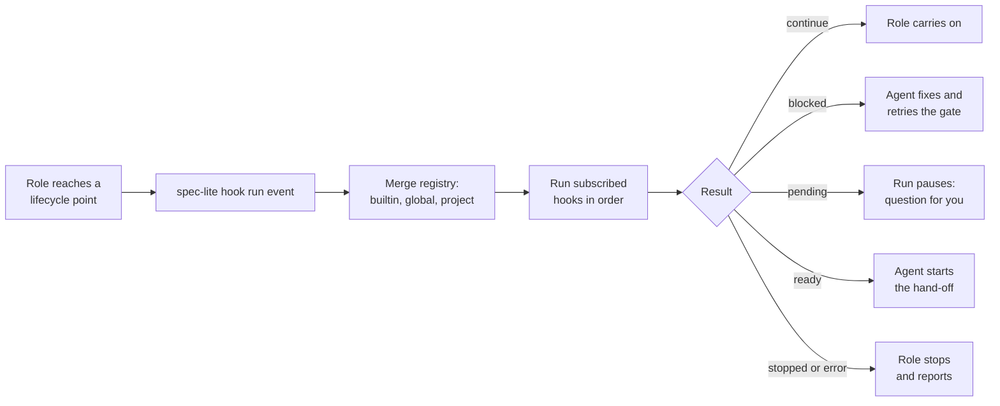

# Hooks

Hooks let you run your own automation at fixed points in the spec-lite workflow.
Every hook-wired role announces its lifecycle points as **events**, such as
`implement.pre`, `review.verdict`, and `fix.post`. A hook subscribes to one or
more events and says what to do there: run a linter, call a webhook, hand off to
another skill, stop for a check that must pass, or pause to ask you a question.

> **You don't run hooks; the roles do.** Brainstorm, Plan, Plan Feature, Feature,
> Implement, Review, Fix, Plan Critic, and YOLO fire their events themselves. You
> add hooks to `.spec-lite/hooks.json`, check them with `spec-lite hook
> validate`, and they fire on the next run. See [Running hooks
> yourself](#running-hooks-yourself) for the few times you'd call one by hand.

Changeset capture, the `changeset.json` that Review uses as its file scope, is
two ordinary hooks that ship enabled. You can disable or replace them like any
other hook.

**Pages in this guide**

- **Hooks** (this page): concepts, adding and managing hooks, built-in hooks, and the reference.
- [Git workflow hooks](hooks-git-workflow.md): a worktree, branch, commits, and a pull request for each piece of work.
- [Gates and checkpoints](hooks-gates-checkpoints.md): checks that block the run, and questions that pause it for you.

**On this page**

- [Concepts](#concepts)
- [How a hook run works](#how-a-hook-run-works)
- [Quick start: run the linter after Implement](#quick-start-run-the-linter-after-implement)
- [Choose a hook type](#choose-a-hook-type)
- [Write each type](#write-each-type)
- [Manage hooks](#manage-hooks)
- [Running hooks yourself](#running-hooks-yourself)
- [Built-in hooks](#built-in-hooks)
- [Reference](#reference)
- [Troubleshooting](#troubleshooting)

## Concepts

| Term | Meaning |
|---|---|
| **Event** | A named lifecycle point, dotted and hierarchical: `implement.task.post` fires after each task. The [event catalog](#event-catalog) lists them all. |
| **Hook** | One entry in the registry. It names the events it subscribes to and what to do there. |
| **Registry** | The merged set of hooks: builtins, then `~/.spec-lite/hooks.json`, then `.spec-lite/hooks.json`. |
| **Payload** | The JSON describing one event: feature, task, changed files, summary, and more. Hooks read it through `${...}` [templates](#interpolation), and `command`/`script` hooks also get it on stdin and as [environment variables](#environment-variables). |
| **Role run** | One run of a role, such as Implement working on FEAT-012. Roles fire their events as a **tracked run**: the CLI saves IDs for the run, so it can pause, hand off, and resume. |
| **Manual run** | `spec-lite hook run` without `--tracked`, as you'd type it. It runs the hooks once and can't pause, so it refuses events that have gates, checkpoints, or hand-off hooks. |
| **Hand-off** | A `skill`, `agent`, or `prompt` hook: when the event's hooks finish, the agent starts that skill, agent, or instruction instead of carrying on. |
| **Gate** | A `command`/`script` hook marked `"gate": true`. If it blocks, the agent fixes the problem and the check runs again. See [Gates](hooks-gates-checkpoints.md#gates). |
| **Checkpoint** | A builtin that pauses the run with a question for you, answered in chat or on GitHub. See [Checkpoints](hooks-gates-checkpoints.md#checkpoints). |

## How a hook run works



1. The role reaches a lifecycle point and runs `spec-lite hook run <event>`.
2. The CLI merges the registry, builds the payload, and resolves every `${...}` template. A configuration problem stops the event here, before anything runs.
3. Hooks run in `order`, lowest first (default `100`); ties go by declaration order. A hook subscribed to a wildcard such as `implement.*` fires on every matching event; `*` matches one or more whole dotted segments.
4. The result tells the role what to do next. Usually that is **continue**. A gate can **block** it, a checkpoint can **pause** it, a hand-off can redirect it, and a failed hook with `"onFailure": "abort"` **stops** it.

## Quick start: run the linter after Implement

The goal: **run the linter after each implementation, and stop the run if it
fails.**

### 1. Write the registry entry

Hooks live in `.spec-lite/hooks.json`. Create it if it does not exist:

```json
{
  "version": 1,
  "hooks": [
    {
      "name": "lint-after-implement",
      "description": "Run the linter after implementation; block on failure.",
      "events": ["implement.post"],
      "type": "command",
      "run": "npm run lint",
      "onFailure": "abort",
      "timeoutMs": 120000
    }
  ]
}
```

`name` is the hook's identity: the key for overriding it in another layer, the
argument to `hook test`, and what appears in the audit log. `version` is the
file format version and is always `1`.

> The file accepts only `version` and `hooks`; a `$schema` key is rejected. For
> editor autocomplete, point your editor at the published
> [`schema/hooks.schema.json`](../../schema/hooks.schema.json) instead.

### 2. Validate it

```bash
spec-lite hook validate
```

```text
Registry valid. 0 warning(s).
```

Validation has no side effects. It checks the JSON schema, event names, every
`${...}` template against the variables its events guarantee, and the ordering
rules. Run it in CI so a broken registry fails the build rather than a delivery
run.

### 3. Test it on its own

`hook test` fires one hook against a synthetic payload, without waiting for a
role to reach the lifecycle point. It runs the real hook, so a `command` hook
really executes:

```bash
spec-lite hook test lint-after-implement --feature FEAT-012
```

```text
REAL hook test: "lint-after-implement" against event implement.post

  ✓ lint-after-implement (command) [ok]
```

### 4. Preview the whole event

`--dry-run` resolves every hook subscribed to an event and prints what *would*
run, without running anything. `${env:...}` values are redacted:

```bash
spec-lite hook run implement.post --feature FEAT-012 --dry-run
```

```text
  − capture-changeset (builtin) [skipped] — dry run — not executed
    builtin:capture-changeset
  − lint-after-implement (command) [skipped] — dry run — not executed
    npm run lint
```

### 5. Let it fire

Nothing else to wire up. The next time Implement finishes a feature, it fires
`implement.post` and your hook runs with it. If the linter fails, Implement stops
and reports the failure. Each run is recorded in the feature's
[audit log](#audit-log).

## Choose a hook type

| You want to… | Use | What happens | Guarantee |
|---|---|---|---|
| Run a tool, script, or check | [`command` or `script`](#command-and-script) | The CLI runs it, with a timeout and a failure policy | Ran, or reported a failure |
| Call a webhook | [`http`](#http) | The CLI sends the request | Same |
| Stop the run until a check passes, and let the agent fix it | `command`/`script` with [`"gate": true`](hooks-gates-checkpoints.md#gates) | A block sends the agent back to fix and retry, within a budget | The agent can't skip it |
| Ask yourself what should happen next | the [`checkpoint` builtin](hooks-gates-checkpoints.md#checkpoints) | The run pauses until you answer in chat or on GitHub | Nothing continues without an answer |
| Start another skill or agent when this point is reached | [`skill` or `agent`](#hand-offs-skill-agent-and-prompt) | The agent starts it after the event's hooks finish | Start and finish are recorded; the work is the agent's |
| Give the agent a free-text instruction | [`prompt`](#hand-offs-skill-agent-and-prompt) | Same as a hand-off | Same |
| Change a shipped behavior | a [built-in hook](#built-in-hooks) | Configure it with a short entry | As for the builtin |

Anything that must happen, such as a formatter, a webhook, or a check, belongs in
a CLI-run type (`command`, `script`, `http`, or a gate). Anything that needs
judgement, such as *"review this deeply"*, belongs in a hand-off, where a model
does the work.

## Write each type

### command and script

The CLI runs `run` in a shell, from the workspace root (or `cwd`), with a
timeout. Exit code `0` is success; anything else is a failure, handled by
`onFailure`. Output on stdout becomes the result message.

`command` and `script` behave identically. The distinction records intent: a
`script` hook usually names a checked-in file, and a `command` hook is a
one-liner. `shell` picks the shell: `auto` (bash on macOS and Linux, PowerShell
on Windows), `bash`, or `pwsh`. `cmd.exe` is deliberately unsupported, because
its quoting rules can't be applied safely.

The hook reads the event in any of three ways:

- **Templates in `run`, `cwd`, and `env`.** Substituted values are shell-quoted, so `${feature.name}` always lands as one argument.
- **stdin.** The full [payload](#payload) as JSON.
- **Environment variables.** `SPEC_LITE_EVENT`, `SPEC_LITE_FEATURE_ID`, `SPEC_LITE_CHANGED_FILES`, and [more](#environment-variables).

```json
{
  "name": "notify-release-channel",
  "events": ["implement.post"],
  "type": "script",
  "run": "node scripts/notify.mjs --channel releases",
  "env": { "NOTIFY_TOKEN": "${env:NOTIFY_TOKEN}" },
  "onFailure": "warn"
}
```

```js
// scripts/notify.mjs: read the payload from stdin.
let input = "";
for await (const chunk of process.stdin) input += chunk;
const payload = JSON.parse(input);
console.log(`${payload.feature.id}: ${payload.changes.files.length} file(s)`);
```

### http

The CLI sends one request. Any `2xx` response is success; anything else, or no
response within `timeoutMs`, is a failure.

| Field | Default | Templates are… |
|---|---|---|
| `url` | required | Percent-encoded |
| `method` | `POST` | — |
| `headers` | `Content-Type: application/json` | Stripped of newlines, so a value can't add a header |
| `bodyTemplate` | the full payload as JSON | JSON-escaped, so the body stays valid |

Secrets never belong in a committed registry. `${env:NAME}` is the only channel
for them, and its value is redacted from `--dry-run` output and the audit log:

```json
{
  "name": "slack-review-verdict",
  "events": ["review.verdict"],
  "type": "http",
  "url": "${env:SLACK_WEBHOOK_URL}",
  "bodyTemplate": "{\"text\":\"Review verdict: ${verdict} — ${summary}\"}",
  "onFailure": "warn"
}
```

### Hand-offs: skill, agent, and prompt

A hand-off hook doesn't run anything in the CLI. It tells the agent to start
another skill (`skill`), agent (`agent`), or free-text instruction (`prompt`).
Hand-offs are how one role chains into another automatically:

```json
{
  "name": "review-after-implement",
  "events": ["implement.post"],
  "type": "skill",
  "skill": "review",
  "args": "review feature ${feature.name}"
}
```

In a role run, the event's other hooks run first. Then, instead of carrying on,
the role gets a `ready` result with a start command, and the agent starts the
hand-off:

```text
Start: spec-lite hook run review.pre --tracked --action a-79c0f1cd0198d58c2a57
```

What to know:

- **It replaces the role.** The agent doesn't return to the role afterwards. On a `.post` event the role was finishing anyway; on a `.pre` event it never starts its own work.
- **One per event.** An event can have only one hand-off or [checkpoint](hooks-gates-checkpoints.md#checkpoints). To offer several next steps, use one checkpoint with a choice for each. `hook validate` reports a second one as an error.
- **Targets that aren't spec-lite roles need `"completion": "reported"`.** That includes every `prompt` hook and any skill or agent from outside spec-lite. The agent then records when it finished with `spec-lite action complete`. spec-lite roles (`review`, `plan-critic`, `fix`, and so on) report completion themselves.
- **Loops are capped.** An automatic chain of hand-offs pauses after `hooks.maxChain` steps (default `8`), or as soon as the same hand-off would repeat. See [Loop limits](hooks-gates-checkpoints.md#automatic-answers-and-loop-limits).
- **It needs a Git checkout**, where the CLI keeps the saved state.

A `prompt` hook carries its instruction in `prompt`:

```json
{
  "name": "changelog-after-implement",
  "events": ["implement.post"],
  "type": "prompt",
  "prompt": "Add a CHANGELOG.md entry for ${feature.id}: ${summary}",
  "completion": "reported"
}
```

In a [manual run](#running-hooks-yourself), a hand-off hook prints a
`SPEC-LITE-DIRECTIVE {...}` line with the resolved target and arguments, and
nothing is saved.

### Passing settings to your own hook

`options` is for [built-in hooks](#built-in-hooks) only; `hook validate` rejects
it on any other type. Your own hook already has a field for each setting:

| Type | Put settings in | Example |
|---|---|---|
| `command` / `script` | Arguments in `run`, or variables in `env` | `"run": "node scripts/notify.mjs --channel releases"`, `"env": { "CHANNEL": "releases" }` |
| `http` | `url`, `headers`, `bodyTemplate` | `"bodyTemplate": "{\"channel\":\"releases\",\"text\":\"${summary}\"}"` |
| `skill` / `agent` | `args` | `"args": "review feature ${feature.name}"` |
| `prompt` | The `prompt` text | `"prompt": "Update CHANGELOG.md for ${feature.id}; keep entries short."` |

Settings can use `${...}` templates for event data, and `${env:NAME}` for
secrets. To reuse one script with different settings, add one hook entry per
setting, each with its own `name`, `run` arguments, or `env`.

## Manage hooks

### Where hooks live

| File | Scope | Shown by `hook list` as |
|---|---|---|
| Shipped with spec-lite | Every repository | `builtin` |
| `~/.spec-lite/hooks.json` | All your repositories | `global` |
| `.spec-lite/hooks.json` | This repository; commit it | `project` |

Later layers win **by name**, in one of two ways:

- **An entry with `type` replaces** the earlier hook of that name outright. That's how you define a hook, or replace a builtin with your own.
- **An entry without `type` configures** the earlier hook. It may set only `enabled`, `options`, `order`, `timeoutMs`, and `onFailure`; everything else comes from the layer that defines the hook. A configured builtin therefore keeps receiving fixes when you update spec-lite. Its `options` replace the earlier options as a whole.

### See what's active

| Command | Answers |
|---|---|
| `spec-lite hook list` | Which hooks are active, which layer defined them, and what they subscribe to |
| `spec-lite hook list --all` | The same, including disabled hooks |
| `spec-lite hook list --event implement.post` | Which hooks fire for one event |
| `spec-lite hook events` | The event catalog |
| `spec-lite hook vars` | Every `${...}` variable, with an example |
| `spec-lite hook validate` | Whether the merged registry is correct |

```text
capture-baseline (builtin) — builtin — enabled
  events: implement.pre, implement.task.pre, fix.pre
  Records HEAD and pre-existing dirt so later diffs are scoped to this run.
capture-changeset (builtin) — builtin — enabled
  events: implement.post, implement.task.post, fix.post
  Diffs against the captured baseline and merges the result into changeset.json.
lint-after-implement (project) — command — enabled
  events: implement.post
  Run the linter after implementation; block on failure.
```

### Change, disable, or delete

| Goal | Do this |
|---|---|
| Stop a hook firing, but keep it | `spec-lite hook disable <name>` |
| Turn it back on | `spec-lite hook enable <name>` |
| Delete a hook you added | Remove its object from `.spec-lite/hooks.json` |
| Configure a builtin | Add a short entry: `{ "name": …, "enabled": …, "options": … }` |
| Replace a builtin's behavior | Add an entry with the builtin's `name` and your own `type` |
| Change it for all your repositories | Use `~/.spec-lite/hooks.json`, or `--global` on `enable`/`disable` |
| Skip hooks for one run only | See [Skipping hooks for one run](#skipping-hooks-for-one-run) |
| Turn off every hook in a clone | `"hooks": { "enabled": false }` in `.spec-lite.json`; see [Project settings](#project-settings) |

`hook enable` and `hook disable` write only the `enabled` value to
`.spec-lite/hooks.json`: on the hook's own entry there, or as a new
`{ "name": …, "enabled": … }` entry that configures a hook defined in an earlier
layer. Nothing else is copied, so builtins keep receiving updates. `--global`
writes `~/.spec-lite/hooks.json` instead; project entries still take precedence.
Unknown names and invalid registries exit `2` without writing anything. Enabling
also validates the hook; neither command runs it.

```bash
spec-lite hook disable capture-changeset
spec-lite hook enable capture-changeset
spec-lite hook disable capture-baseline --global
```

Replacing a builtin, same name with a different body:

```json
{
  "version": 1,
  "hooks": [
    {
      "name": "capture-changeset",
      "events": ["implement.post"],
      "type": "command",
      "run": "node scripts/my-changeset.mjs ${feature.dir}"
    }
  ]
}
```

To ship a hook your team can opt into, include `"enabled": false` in its
definition. It shows in `hook list --all`, and `hook enable <name>` turns it on.

## Running hooks yourself

You rarely need `spec-lite hook run`: roles call it themselves at every
lifecycle point, with `--tracked` and the IDs of their run. Call it yourself to:

- **Preview** what an event would run, with no side effects:

  ```bash
  spec-lite hook run implement.post --feature FEAT-012 --dry-run
  ```

- **Fire events for work you do without an agent.** For example, to use the
  [Git workflow hooks](hooks-git-workflow.md) for a fix you make by hand, run
  `fix.pre` before you start. It creates the worktree and prints its path; make
  your edits there. Then run `fix.post` from that worktree to commit, push, and
  open the pull request:

  ```bash
  spec-lite hook run fix.pre --payload name=auth-issue
  spec-lite hook run fix.post --payload name=auth-issue --payload summary="Fix token refresh"
  ```

- **Script it in CI.**

These are manual runs: they run each hook once and can't pause. If a gate,
checkpoint, or hand-off hook subscribes to the event, a manual run stops with
exit `2` and says so. `--dry-run` still previews them. Every option is in the
[CLI reference](../usage.md#hook-run-event).

### Skipping hooks for one run

No registry change is needed:

| Where | How |
|---|---|
| A whole agent session | Start the agent from a shell with `SPEC_LITE_SKIP_HOOKS=create-pull-request` (comma-separated names, or `*` for all). Every hook call in that session skips them. |
| One role run | Ask the agent: *"implement FEAT-020, but skip create-pull-request"*. It adds `--skip create-pull-request` to its hook calls for that run. |
| One manual call | Add `--skip <name>`, repeated for several, or `--skip '*'` for all. |

Skipped hooks aren't validated for that run; everything else still is. To work
without the Git workflow for one run, skip all three of its hooks,
`prepare-worktree,commit-progress,create-pull-request`. Skipping only
`prepare-worktree` makes `commit-progress` fail, because it commits only inside
the worktree that `prepare-worktree` creates.

## Built-in hooks

Seven builtins ship with the CLI. They are ordinary hooks with the same fields
and failure policy as yours, and they run in-process, without needing
`spec-lite` on `PATH`.

| Name | Subscribed to | On by default | Does | More |
|---|---|---|---|---|
| `capture-baseline` | `implement.pre`, `implement.task.pre`, `fix.pre` | yes | Records HEAD and whatever is already dirty, so pre-existing edits are never attributed to this run | [Changeset capture](#changeset-capture) |
| `capture-changeset` | `implement.post`, `implement.task.post`, `fix.post` | yes | Diffs against that baseline and merges the result into the feature's `changeset.json` | [Changeset capture](#changeset-capture) |
| `changeset-from-pr` | nothing until you subscribe it | no | Reads the changed files from the open pull request instead | [Changeset capture](#changeset-capture) |
| `prepare-worktree` | `implement.pre`, `implement.task.pre`, `fix.pre` | no | Creates or resumes the work's worktree and branch | [Git workflow](hooks-git-workflow.md) |
| `commit-progress` | `implement.task.post`, `implement.post`, `fix.post` | no | Commits each task; commits the rest and pushes at completion | [Git workflow](hooks-git-workflow.md) |
| `create-pull-request` | `implement.post`, `fix.post` | no | Opens or reuses the work's pull request | [Git workflow](hooks-git-workflow.md) |
| `checkpoint` | whatever you subscribe it to | — | Pauses the run with a question for you | [Checkpoints](hooks-gates-checkpoints.md#checkpoints) |

**Options.** Only `checkpoint` and the three Git workflow builtins take
`options`. They are listed on the pages that explain them:
[Git workflow options](hooks-git-workflow.md#options) and
[checkpoint options](hooks-gates-checkpoints.md#checkpoint-options).
`hook validate` rejects unknown options, and the published schema gives editors
autocomplete for each builtin.

**Configure, don't copy.** To turn a builtin on or off, or set its options, add
a short entry with only those settings:

```json
{
  "version": 1,
  "hooks": [
    { "name": "capture-changeset", "enabled": false }
  ]
}
```

### Changeset capture

`capture-baseline` and `capture-changeset` produce
`.spec-lite/features/FEAT-###-<name>/changeset.json`:

```json
{
  "vcs": "git",
  "featureId": "FEAT-012",
  "baseline": {
    "sha": "bc8bd13cb251b7e397cda10b561d2ed7611859a9",
    "capturedAt": "2026-08-21T14:03:11.204Z",
    "dirtyAtBaseline": []
  },
  "files": [
    { "path": "src/auth/session.ts", "status": "M", "role": "implement" },
    { "path": "src/auth/expiry.ts", "status": "U", "role": "implement" }
  ],
  "excluded": [".spec-lite/features/FEAT-012-user_management/changeset.json"]
}
```

This is a **baseline-anchored diff, not git history**: it covers exactly the work
done since the `*.pre` event. Review reads it as the authoritative scope for
`review feature` and `review plan`, falling back to a spec's `Touched Files`
section only for features created before hooks existed. See
[Review](review.md).

- **Generated output is filtered out:** `dist/`, `build/`, `out/`, `node_modules/`, `package-lock.json`, `yarn.lock`, `pnpm-lock.yaml`, and `.spec-lite/` itself.
- **Commit `changeset.json` with the work**, because Review reads it. Its content changes only when the set of changed files does. Capture times are in the local [audit log](#audit-log).
- **Without `--feature`** (an ad-hoc fix), capture is skipped with a note rather than failing.
- **Outside a Git repository**, capture is disabled and reported; Review falls back to the manual list.
- **Disabling both builtins** turns capture off. Every other hook keeps working.

`changeset-from-pr` is an alternative for pull-request-first teams. It uses
`gh pr diff --name-only` for the current branch's open pull request, so it needs
`gh` on `PATH` and an open PR. It merges into the same `changeset.json`, so
disable `capture-changeset` when you use it, unless you want both sources
combined. It subscribes to nothing until you name the events:

```json
{
  "name": "changeset-from-pr",
  "events": ["implement.post"],
  "type": "builtin",
  "builtin": "changeset-from-pr"
}
```

### Shipped definitions

For reference, this is how the builtins with fixed subscriptions ship. You
never copy these; configure them with a short entry as shown above.
`changeset-from-pr` and `checkpoint` are not listed because they ship
unsubscribed.

<!-- builtin-hooks-json:start -->
```json
{
  "version": 1,
  "hooks": [
    {
      "name": "prepare-worktree",
      "events": [
        "implement.pre",
        "implement.task.pre",
        "fix.pre"
      ],
      "type": "builtin",
      "builtin": "prepare-worktree",
      "description": "Create or resume the workflow's branch and worktree before code changes.",
      "enabled": false,
      "order": 0,
      "onFailure": "abort",
      "timeoutMs": 300000
    },
    {
      "name": "capture-baseline",
      "events": [
        "implement.pre",
        "implement.task.pre",
        "fix.pre"
      ],
      "type": "builtin",
      "builtin": "capture-baseline",
      "description": "Records HEAD and pre-existing dirt so later diffs are scoped to this run.",
      "enabled": true,
      "order": 10,
      "onFailure": "warn"
    },
    {
      "name": "capture-changeset",
      "events": [
        "implement.post",
        "implement.task.post",
        "fix.post"
      ],
      "type": "builtin",
      "builtin": "capture-changeset",
      "description": "Diffs against the captured baseline and merges the result into changeset.json.",
      "enabled": true,
      "order": 10,
      "onFailure": "warn"
    },
    {
      "name": "commit-progress",
      "events": [
        "implement.task.post",
        "implement.post",
        "fix.post"
      ],
      "type": "builtin",
      "builtin": "commit-progress",
      "description": "Commit verified tasks; commit and push completed implementations and fixes.",
      "enabled": false,
      "order": 200,
      "onFailure": "abort",
      "timeoutMs": 120000
    },
    {
      "name": "create-pull-request",
      "events": [
        "implement.post",
        "fix.post"
      ],
      "type": "builtin",
      "builtin": "create-pull-request",
      "description": "Create or reuse the workflow's PR against the configured target branch.",
      "enabled": false,
      "order": 300,
      "onFailure": "abort",
      "timeoutMs": 120000
    }
  ]
}
```
<!-- builtin-hooks-json:end -->

## Reference

### Hook fields

| Field | Applies to | Default | Meaning |
|---|---|---|---|
| `name` | all | — | **Required.** Unique identity, and the key for overriding the hook in a later layer |
| `events` | all | — | **Required.** Event names or wildcard patterns (`implement.*`) |
| `type` | all | — | **Required** for a new hook: `command`, `script`, `http`, `builtin`, `skill`, `agent`, `prompt`. Leave it out to [configure](#where-hooks-live) an existing hook |
| `description` | all | — | Shown by `hook list` |
| `enabled` | all | `true` | `false` keeps the hook defined but never runs it |
| `order` | all | `100` (gates `15`, checkpoints `20`) | Lower runs first; ties go by declaration order |
| `onFailure` | all | `warn` | `warn` (log and continue), `abort` (stop the run, exit `1`), `ignore` (continue silently) |
| `timeoutMs` | `command`, `script`, `http`, `builtin` | `30000` | Time budget before the hook is stopped and reported as failed |
| `once` | all | `false` | Skip if the hook already succeeded on this event for the same feature (manual runs) or workflow (role runs) |
| `payloadSchema` | all | — | JSON Schema the payload must match before the hook runs; a mismatch is a [contract error](#results-and-exit-codes) |
| `run` | `command`, `script` | — | Command line or script path. Templates are shell-quoted |
| `shell` | `command`, `script` | `auto` | `auto` (bash, or PowerShell on Windows), `bash`, `pwsh` |
| `cwd` | `command`, `script` | workspace root | Working directory, relative to the workspace root |
| `env` | `command`, `script` | — | Extra environment variables; values support templates |
| `gate` | `command`, `script` | `false` | Make the hook a [gate](hooks-gates-checkpoints.md#gates). Needs `onFailure: "abort"` |
| `maxRounds` | gates | `3` | How many times a gate may run in one event, counting the first check (1–100) |
| `url` | `http` | — | Target URL |
| `method` | `http` | `POST` | HTTP method |
| `headers` | `http` | `Content-Type: application/json` | Extra request headers |
| `bodyTemplate` | `http` | the full payload as JSON | Request body |
| `builtin` | `builtin` | the hook's `name` | Which builtin to run, for example `checkpoint` |
| `options` | `builtin` | — | Settings of a builtin that takes them; see [Built-in hooks](#built-in-hooks) |
| `skill` / `agent` | `skill`, `agent` | — | The skill or agent to hand off to |
| `prompt` | `prompt` | — | The instruction to hand off |
| `args` | `skill`, `agent` | — | Arguments for the target; supports templates |
| `completion` | `skill`, `agent`, `prompt` | — | `"reported"`: the target isn't a spec-lite role, so the agent records completion itself. Required for `prompt` |

### Environment variables

**Set by spec-lite for `command` and `script` hooks**

| Variable | When set | Value |
|---|---|---|
| `SPEC_LITE_EVENT` | Always | Event name, such as `implement.post` |
| `SPEC_LITE_FEATURE_ID` | The event has a feature | `FEAT-012` |
| `SPEC_LITE_FEATURE_DIR` | The event has a feature | `.spec-lite/features/FEAT-012-user_management` |
| `SPEC_LITE_CHANGED_FILES` | A changeset was captured | Changed paths, one per line |
| `SPEC_LITE_PAYLOAD_FILE` | Always | A temporary file holding the payload JSON, the same content as stdin. Deleted after the hook |
| `SPEC_LITE_RESPONSE_FILE` | Gates; empty for other hooks | Where a gate writes its [answer](hooks-gates-checkpoints.md#write-a-gate) |
| `SPEC_LITE_EXECUTION_ID` | Role runs; empty in manual runs | The ID of the role run that fired the event |
| `SPEC_LITE_HOOK_DEPTH`, `SPEC_LITE_HOOK_CHAIN` | Always | Loop guard: a hook that calls `spec-lite` again is stopped at depth 3. Don't set these yourself |

**Set by you**

| Variable | Effect |
|---|---|
| `SPEC_LITE_SKIP_HOOKS` | Comma-separated hook names, or `*`, to skip in this process and its children. See [Skipping hooks for one run](#skipping-hooks-for-one-run) |

A custom pull-request adapter gets its own `SPEC_LITE_PR_*` variables; see
[Custom PR provider](hooks-git-workflow.md#custom-pr-provider).

### Payload

Every hook receives the same payload. Fields appear only when the event has
them; see the [event catalog](#event-catalog) for what each event guarantees.

```json
{
  "hooksVersion": 1,
  "event": "implement.post",
  "role": "implement",
  "phase": "post",
  "runId": "01J9F2K7M4",
  "timestamp": "2026-08-21T14:03:11.204Z",
  "cwd": "/repo",
  "provider": "claude-code",
  "feature": {
    "id": "FEAT-012",
    "name": "user_management",
    "dir": ".spec-lite/features/FEAT-012-user_management",
    "spec": ".spec-lite/features/FEAT-012-user_management/spec.md"
  },
  "changes": {
    "source": "git",
    "baseline": "bc8bd13",
    "head": "4e1a9c0",
    "files": [{ "path": "src/auth/session.ts", "status": "M", "role": "implement" }]
  },
  "summary": "Added session expiry handling"
}
```

Other fields include `task`, `plan`, `report`, `verdict`, `verdictCode`, `name`
(a fix's name), `worktree` (after `prepare-worktree`), and, in role runs,
`workflow`, `execution`, and `eventId`. Any `--payload key=value` passed to
`hook run` is added as a top-level field.

### Interpolation

`${...}` templates work in `run`, `cwd`, `env`, `url`, `headers`,
`bodyTemplate`, `args`, and `prompt`, and in checkpoint options (`question`,
`inputs`, `attach`, and choice `args`). Each is resolved in a **single pass**, so
a substituted value is never re-scanned and payload text can't inject further
references. It is then escaped for where it lands:

| Field | Escaping |
|---|---|
| `run` | Shell-quoted, so a value always lands as exactly one argument |
| `url` | Percent-encoded |
| `bodyTemplate` | JSON-escaped, so the body stays parseable |
| `headers` | Newlines become a space and control characters are dropped, so a value can't add a header |
| `cwd`, `env`, `args`, `prompt`, checkpoint options | Raw: no shell or wire format is involved |

```text
${name}                 a variable from the table below
${name:-default}        with a fallback when it has no value
${env:NAME}             a process environment variable
${env:NAME:-default}    with a fallback
$${                     a literal "${"
```

Resolution **fails closed**. A reference with no value is an error that stops
the hook before it runs; it never becomes an empty string. Each event declares
which variable groups it guarantees, and `spec-lite hook validate` rejects a
template that relies on a group its events don't guarantee:

```text
[error] "bad-var": ${task.id} has no guaranteed value on implement.post. Subscribe to an event that provides "task", or write ${task.id:-default}.
```

Write `${task.id:-none}` wherever a value may legitimately be absent.

`${env:NAME}` reads only the real process environment, and its value is redacted
from `--dry-run` output and `hooks.log.jsonl`. It is the only place a secret
belongs: write an `Authorization` header as `"Bearer ${env:API_TOKEN}"`, never as
the token itself.

<!-- hook-vars-table:start -->
| Variable | Group | Meaning | Example |
|---|---|---|---|
| `${plan.file}` | plan | Workspace-relative path of the plan the role works on. | `.spec-lite/plan_orders.md` |
| `${plan.name}` | plan | Plan name: the plan file name without `plan_` and `.md`. | `orders` |
| `${report.file}` | report | Workspace-relative path of the report the role wrote. | `.spec-lite/reviews/review_orders.md` |
| `${verdict.code}` | verdict | Machine-readable verdict: Plan Critic `ready`, `revisions` or `replan`; Review `pass`, `changes-required` or `blocked`. | `ready` |
| `${workflow.id}` | workflow — tracked runs | ID of the saved workflow (one per feature, plan, fix, review or YOLO run). Tracked runs only. | `w-1234` |
| `${execution.id}` | execution — tracked runs | ID of the role run that fired the event. Tracked runs only. | `x-1234` |
| `${action.id}` | action — optional | ID of the saved action this role run was started from, if any; write `${action.id:-none}`. | `a-1234` |
| `${decision.id}` | decision — checkpoint events | Checkpoint ID, as used by `spec-lite decide`. | `d-1234` |
| `${decision.question}` | decision — checkpoint events | The checkpoint question, with templates resolved. | `Plan orders is ready. What next?` |
| `${decision.status}` | decision — checkpoint events | `pending`, `answered`, `expired`, `cancelled` or `superseded`. | `pending` |
| `${decision.url}` | decision — checkpoint events | Link to the GitHub comment, when the checkpoint was posted there; write `${decision.url:-}`. | `https://github.com/acme/app/issues/7#issuecomment-1` |
| `${decision.choice}` | decision-resolved — after an answer | The chosen choice ID. | `critique` |
| `${decision.actor}` | decision-resolved — after an answer | Who answered: `local-session`, `configured-rule`, or a GitHub login. | `local-session` |
| `${decision.feedbackFile}` | decision-resolved — after an answer | Absolute path of a file holding the answer's free-text feedback. | `/repo/.git/spec-lite/decisions/d-1234/feedback.md` |
| `${event}` | base — every event | Full dotted event name. | `implement.post` |
| `${role}` | base — every event | Agent or skill that emitted the event. | `implement` |
| `${phase}` | base — every event | Lifecycle position: pre, post, or signal. | `post` |
| `${runId}` | base — every event | Stable id for one `hook run` invocation. | `01J9F2K7M4` |
| `${timestamp}` | base — every event | ISO-8601 UTC timestamp of the run. | `2026-08-21T14:03:11.204Z` |
| `${cwd}` | base — every event | Absolute workspace root. | `/repo` |
| `${provider}` | base — every event | Configured harness alias, or "unknown". | `claude-code` |
| `${payload}` | base — every event | The entire payload as compact JSON. | `{"event":"implement.post",…}` |
| `${payload.file}` | base — every event | Path to a temp file holding the payload JSON. | `/tmp/spec-lite-x.json` |
| `${feature.id}` | feature | Stable feature identifier. | `FEAT-012` |
| `${feature.name}` | feature | Snake_case feature name. | `user_management` |
| `${feature.dir}` | feature | Feature directory, workspace-relative. | `.spec-lite/features/FEAT-012-user_management` |
| `${feature.spec}` | feature | Feature spec path, workspace-relative. | `.spec-lite/features/FEAT-012-user_management/spec.md` |
| `${task.id}` | task | Task identifier within a feature. | `TASK-003` |
| `${changes.count}` | changes | Number of files in the captured changeset. | `12` |
| `${changes.source}` | changes | How the changeset was captured: git, gh, or none. | `git` |
| `${changes.baseline}` | changes | Baseline commit the changeset is diffed against. | `abc1234` |
| `${changes.head}` | changes | HEAD of the checkout when the event fired. | `def5678` |
| `${changes.files}` | changes | Changed paths, newline-separated. | `src/a.ts\nsrc/b.ts` |
| `${verdict}` | verdict | Review verdict. | `Request changes` |
| `${summary}` | summary | One-line summary supplied by the emitting role. | `Added session expiry handling` |
| `${env:NAME}` | environment | A process environment variable — the only channel for secrets. | `${env:SLACK_WEBHOOK_URL}` |
<!-- hook-vars-table:end -->

`${provider}` reads `provider` (then the first entry of `providers`) from
`.spec-lite.json`, and resolves to `unknown` when neither is set, so it never
needs a `:-default`.

### Event catalog

`emitted` events fire today. `planned` events are declared so that subscribing to
them validates with a warning instead of an unknown-event error; they begin
firing in a later release. **Guarantees** lists the [variable groups](#interpolation)
each event always provides. A group not listed may still be present at run time
(a Fix often maps to a feature), but a template relying on it needs a
`${name:-default}`.

<!-- hook-events-table:start -->
| Event | Role | Status | Guarantees |
|---|---|---|---|
| `brainstorm.pre` | brainstorm | emitted | — |
| `brainstorm.post` | brainstorm | emitted | `summary` |
| `plan.pre` | plan | emitted | `plan` |
| `plan.post` | plan | emitted | `plan`, `summary` |
| `plan-feature.pre` | plan-feature | emitted | — |
| `plan-feature.post` | plan-feature | emitted | `feature`, `summary` |
| `architect.pre` | architect | planned | — |
| `architect.post` | architect | planned | `summary` |
| `plan-critic.pre` | plan-critic | emitted | `plan` |
| `plan-critic.post` | plan-critic | emitted | `plan`, `report`, `verdict`, `summary` |
| `build-data-model.pre` | build-data-model | planned | — |
| `build-data-model.post` | build-data-model | planned | `summary` |
| `feature.pre` | feature | emitted | — |
| `feature.post` | feature | emitted | `summary` |
| `feature.spec.post` | feature | emitted | `feature`, `summary` |
| `implement.pre` | implement | emitted | `feature` |
| `implement.post` | implement | emitted | `feature`, `changes`, `summary` |
| `implement.task.pre` | implement | emitted | `feature`, `task` |
| `implement.task.post` | implement | emitted | `feature`, `task`, `changes` |
| `implement.feature.post` | implement | emitted | `feature`, `changes`, `summary` |
| `review.pre` | review | emitted | — |
| `review.post` | review | emitted | `report`, `verdict`, `summary` |
| `review.verdict` | review | emitted | `report`, `verdict`, `summary` |
| `fix.pre` | fix | emitted | — |
| `fix.post` | fix | emitted | `changes`, `summary` |
| `write-unit-tests.pre` | write-unit-tests | planned | — |
| `write-unit-tests.post` | write-unit-tests | planned | `summary` |
| `write-integration-tests.pre` | write-integration-tests | planned | — |
| `write-integration-tests.post` | write-integration-tests | planned | `summary` |
| `document.pre` | document | planned | — |
| `document.post` | document | planned | `summary` |
| `document-design.post` | document-design | planned | `summary` |
| `document-feature.post` | document-feature | planned | `feature`, `summary` |
| `document-usage.post` | document-usage | planned | `summary` |
| `document-readme.post` | document-readme | planned | `summary` |
| `devops.pre` | devops | planned | — |
| `devops.post` | devops | planned | `changes`, `summary` |
| `memorize.post` | memorize | planned | `summary` |
| `todo.post` | todo | planned | `summary` |
| `tool-help.post` | tool-help | planned | `summary` |
| `yolo.pre` | yolo | emitted | — |
| `yolo.post` | yolo | emitted | `summary` |
| `yolo.phase.post` | yolo | planned | `summary` |
| `hook.error` | * | emitted | `summary` |
| `checkpoint.pending` | * | emitted | `decision`, `workflow`, `summary` |
| `checkpoint.resolved` | * | emitted | `decision`, `decision-resolved`, `workflow`, `summary` |
<!-- hook-events-table:end -->

`checkpoint.pending` and `checkpoint.resolved` fire when a checkpoint asks and is
answered; use them for notifications. Only CLI-run hooks (`command`, `script`,
`http`) run on them. See [Notifications](hooks-gates-checkpoints.md#notifications).

`hook.error` fires after a hook fails, with a `${summary}` naming the failures,
and never recurses into itself:

```json
{
  "name": "hook-failures-to-slack",
  "events": ["hook.error"],
  "type": "http",
  "url": "${env:SLACK_WEBHOOK_URL}",
  "bodyTemplate": "{\"text\":\"spec-lite hook failure: ${summary}\"}"
}
```

### Results and exit codes

| Exit | Meaning | What the role does |
|---|---|---|
| `0` | The event finished. In a role run, read the **status**: it may also be paused, handed off, or stopped | Follows the status |
| `1` | A hook with `onFailure: "abort"` failed, a gate failed to answer, or an operation failed | Stops and reports |
| `2` | A **contract error**; see below | Stops; fix the configuration |
| `3` | A gate blocked (role runs) | Fixes the problem and retries the gate |
| `4` | Busy: another spec-lite process holds the state lock (role runs) | Retries shortly |

A **contract error** means the event couldn't run as configured: the event name
isn't in the catalog, the registry failed validation, a `${...}` had no value,
the payload failed a hook's `payloadSchema`, or the call was missing something
it needs, such as scope or IDs. Contract errors bypass `onFailure` and stop the
event *before* anything with side effects runs.

```text
  ✗ needs-summary (command) [failed] — ${summary} has no value on event "fix.post".
    Write ${summary:-default} to allow it to be absent.
exit 2
```

Firing a catalog event that nothing subscribes to is a normal no-op with exit
`0`. An event name outside the catalog exits `2`, so a typo is loud instead of
silently skipping every hook.

Role runs report a **status** alongside the exit code, which the role follows:

| Status | Meaning |
|---|---|
| `continue` | Carry on |
| `blocked` | A gate blocked; fix and retry |
| `pending` | A checkpoint is waiting for an answer |
| `ready` | A hand-off or chosen action is ready to start |
| `stopped` | The run was told to stop |
| `error` | Something failed; the result says what and how to recover |

In text output, each result ends with one `SPEC-LITE-<STATUS> {json}` line,
preceded by `SPEC-LITE-CONTEXT` (the run's IDs) and, after `prepare-worktree`,
`SPEC-LITE-WORKTREE` (where to work). `--json` prints the JSON alone. These
lines are for the agent; `spec-lite next` shows the same state for people.

### Project settings

In `.spec-lite.json`:

| Setting | Default | Meaning |
|---|---|---|
| `hooks.enabled` | `true` | `false` turns off every hook in this clone, such as for CI, a fork, or a bisect, without editing the registry. Roles keep working; nothing runs. |
| `hooks.maxChain` | `8` | How many automatic hand-offs one chain may take (1–100). See [Loop limits](hooks-gates-checkpoints.md#automatic-answers-and-loop-limits). |

```json
{ "hooks": { "enabled": false } }
```

### Audit log

Every hook run for a feature is appended to
`.spec-lite/features/FEAT-###-<name>/hooks.log.jsonl`, one JSON object per line:

```json
{"at":"2026-08-21T14:03:11.445Z","name":"capture-baseline","event":"implement.pre","kind":"builtin","status":"ok","durationMs":165,"message":"baseline bc8bd13 captured (0 pre-dirty)"}
```

`once: true` reads it in manual runs. The log is local diagnostics: the first
time a clone writes one, spec-lite adds `.spec-lite/**/hooks.log.jsonl` to
`.git/info/exclude`, and automatic commits refuse to include it. To make the
rule visible to your team, add the same line to `.gitignore`. A log committed by
an earlier version stays tracked until you `git rm --cached` it.

## Troubleshooting

| Symptom | Cause | Fix |
|---|---|---|
| Hook never fires | Not subscribed to the event you think, or disabled | `spec-lite hook list --all --event <name>` |
| Nothing happens, exit `0` | No hook subscribes to that event | `spec-lite hook list --event <name>` |
| `unknown event`, exit `2` | The event name isn't in the catalog | `spec-lite hook events` to check the spelling |
| Exit `2` before anything ran | Registry error, or a `${...}` with no value | `spec-lite hook validate` |
| `only builtin hooks take options` | `options` on your own hook | Use `run`/`env`, `args`, or the type's own fields; see [Passing settings](#passing-settings-to-your-own-hook) |
| `only one hand-off … or checkpoint hook may subscribe` | Two hand-offs, or a hand-off and a checkpoint, on one event | Combine them into one checkpoint with a choice each |
| `needs "completion": "reported"` | A `prompt` hook, or a target outside spec-lite | Add `"completion": "reported"` |
| `tracked-required` on a manual `hook run` | The event has a gate, checkpoint, or hand-off | Let the role fire it, add `--dry-run` to preview, or `--skip` those hooks |
| `${env:X}` warning at validate time | The variable isn't set in this shell | Set it wherever hooks run, or add `:-default` |
| Builtin still active after disabling | The entry name doesn't match exactly | Reuse the exact name, such as `capture-changeset` |
| Changeset empty | No `--feature`, no baseline, or not a Git repository | Check the `capture-baseline` line in `hooks.log.jsonl` |
| A hand-off didn't start | The run has no Git checkout, or the chain limit was reached | Run `spec-lite next` to see the saved state |

## Related

- [Git workflow hooks](hooks-git-workflow.md): a worktree, branch, and pull request per piece of work
- [Gates and checkpoints](hooks-gates-checkpoints.md): checks that block the run, and questions that pause it
- [CLI reference](../usage.md#hook): every `spec-lite hook` command and option
- [Review](review.md): how `changeset.json` becomes review scope
- [Architecture](../architecture.md): where hooks sit in the overall design
