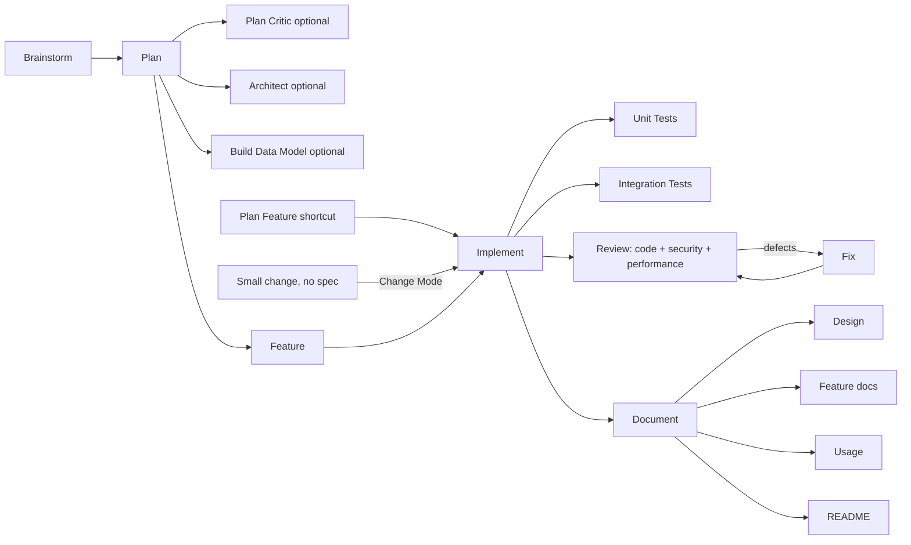

# Orchestrator — Pipeline Reference

This is the agent-facing source of truth for how spec-lite roles cooperate. Individual prompts own their detailed process; this reference owns cross-cutting contracts.

## Pipeline



**Memorize**, **TODO**, **Tool Helper**, **Help**, and **YOLO** are cross-cutting. YOLO orchestrates the pipeline; it does not replace specialist instructions.

## Artifact Ownership

| Artifact / field | Writer | Readers / contract |
|---|---|---|
| `.spec-lite/memory.md` | Memorize; core roles following Memory Capture | All relevant roles treat entries as hard requirements; only Memorize reorganizes |
| `.spec-lite/plan*.md` content and IDs | Plan; Feature may back-fill legacy ID rows | Downstream roles; user edits win |
| Plan `Spec File` | Feature | Implement and Review resolve specs from it |
| Plan `Status` | Implement only | Feature/Review/Document read only |
| Feature spec content | Feature or Plan Feature | Implement executes it |
| Feature `State Tracking` | Implement only | Review confirms every task is complete before using the feature as a scope |
| Feature `changeset.json` / `hooks.log.jsonl` | The `capture-baseline`/`capture-changeset` hooks, fired by Implement and Fix at `*.pre`/`*.post` | Review uses `changeset.json` as the deterministic scope; a hand-maintained `## Touched Files` list in the spec is the legacy fallback only when `changeset.json` is absent |
| `.spec-lite/reviews/changeset/chg_<name>.json`, `fix_<issue>.json` | The same hooks, for a Change Mode run or a fix without `--feature` | Review's `review change` / `review fix` scope; a project may git-ignore the directory |
| `.spec-lite/reviews/chg_<name>.md` | Implement (Change Mode) | Request, Done-when checks and outcome; Review judges the change against it |
| `.spec-lite/data_model.md` | Build Data Model | Feature/Implement/Review treat it as authoritative schema |
| `.spec-lite/feature-summary.md` | Implement (all modes) and Fix | AI-facing current behavior; headings retain `FEAT-###` |
| `.spec-lite/reviews/review_<scope>.md` | Review; Fix/Implement may add resolution notes | Review recommends; Fix/Implement remediate |
| `.spec-lite/TODO.md` | TODO plus roles tracking out-of-scope work | Backlog only, never implicit current scope |
| `README.md`, configured docs | Document writer family | Human-facing current state |
| `.spec-lite/yolo_state.md` | YOLO | Resume after reconciling durable `spec-lite next` control state |
| `<git-common-dir>/spec-lite/` decisions/actions/events | CLI (tracked runs) | Local runtime state shared by linked worktrees; never commit, package or attach by default |

## Precedence and Conflicts

1. Current user instruction and user-authored artifact edits.
2. `.spec-lite/memory.md` standing rules.
3. Explicit, justified plan-specific overrides for that plan.
4. Authoritative data model and completed feature specs.
5. Evidence from current code/tests/tools.
6. Prompt defaults.

Never silently reinterpret a conflict. Surface the exact competing rules and the smallest decision needed. Review findings do not rewrite plans or code; bugs, vulnerabilities, and bottlenecks route to **Fix**; a small enhancement to existing behavior routes to **Implement** Change Mode; missing product behavior routes to **Feature**.

## Context and Isolation

- Read only artifacts required by the active role and user request; user modifications are intentional.
- Feature and implementation Plan Modes use a fresh subagent per feature, sequentially. Precompute legacy feature IDs before fan-out; serialize writes to shared plans/docs.
- Conversation history is not an artifact. Re-read memory, plan, spec, and current code for each isolated feature.
- If a mandatory artifact is missing, stop and name the producer that must create it. Do not invent or silently skip it.
- If multiple plan files exist in `.spec-lite/`, ask the user which plan applies.

## Deterministic Feature IDs

Use one repository-wide `FEAT-###` sequence. IDs are immutable, never reused, and remain gapped after deletion.

1. Scan the `ID` column of the High-Level Features table in **every** plan file (`.spec-lite/plan*.md`).
2. Scan `.spec-lite/features/` for `FEAT-###-<name>` directories and legacy `FEAT-FP-###-<name>` directories; read the highest numeric suffix across both formats — the ID is in the path itself, so this is a directory listing, not a content grep. Preserve existing `FEAT-FP-###` IDs, but never allocate a new one.
3. Next ID = highest number found + 1; if none found, `FEAT-001`.

Plan assigns IDs for plan rows; Plan Feature assigns one standalone ID; Feature copies the plan ID and only allocates/back-fills legacy rows. Implement, Review, and Document Feature are read-only consumers.

## Review Protocol

Review accepts exactly one deterministic scope:

- `review files <paths/globs>`: exact existing matches; reject none.
- `review feature <name>`: the feature's `changeset.json` (Touched Files fallback if absent); reject incomplete/empty scope.
- `review plan [file]`: union of completed features' `changeset.json` (Touched Files fallback per feature); list skipped incomplete rows and reject when none are complete.
- `review change <name>`: `.spec-lite/reviews/changeset/chg_<name>.json`, judged against `.spec-lite/reviews/chg_<name>.md`; reject an absent or empty changeset.
- `review fix <issue>`: `.spec-lite/reviews/changeset/fix_<issue>.json`, judged against `.spec-lite/reviews/fix_<issue>.md`; reject an absent or empty changeset, pointing a feature-targeted fix to `review feature`.
- `review dependencies [paths/globs]`: named/matched manifests/lockfiles and their graphs, or all project manifests/lockfiles under the workspace root when paths are omitted; reject unmatched explicit paths.

Consolidated reviews cover code correctness/testing, security, performance, and dependency vulnerabilities by default. Explicit vulnerability requests to Review or a reviewer subagent use the same dependency procedure; without another scope, resolve `review dependencies`. A user-requested vulnerability-only focus may omit unrelated dimensions, recorded in the report. Owning manifests/lockfiles are declared dependency evidence even when excluded from source review. Use live GitHub Advisories by default unless explicitly overridden; report coverage gaps and qualified verdicts rather than claiming clean results. Every run uses `REV-###` and writes `.spec-lite/reviews/review_<scope>.md` with Critical/High/Medium/Low severity, one verdict, and practical remediation/validation guidance.

## Documentation Protocol

`.spec-lite.json` contains:

```json
{
  "documentation": {
    "directory": "docs",
    "level": "technical",
    "updateWithDevelopment": true
  }
}
```

- `technical`: `README.md` plus `<docs-dir>/architecture.md`.
- `full`: technical set plus `quickstart.md`, `usage.md`, and one `features/<feature>.md` per implemented feature.
- Document full/update/targeted mode delegates Design → Feature writers → Usage → README sequentially.
- Mermaid is required for architecture/design. Commands/examples are verified. Missing license/contribution facts are asked, never invented.
- Implement/Fix invoke Document update when `updateWithDevelopment` is true; otherwise they suggest it.
- Legacy `docs/explore/` is input material for the first full run, not a continuing output.

## Memory Protocol

Memory is the authoritative project-wide instruction set. The [Memorize skill](../skills/memorize/SKILL.md#memory-capture-protocol) owns taxonomy, conflict resolution, deduplication, bootstrap, and restructuring.

At task end, Implement, Fix, Feature, Plan, Plan Feature, Review, Brainstorm, and Architect may auto-capture at most three durable user rules or multiply-verified codebase conventions. They append only non-conflicting entries with `*(auto-captured YYYY-MM-DD)*`, report captures, and leave conflicts unchanged for user resolution.

## Hook Protocol

Hook-wired roles are Brainstorm, Plan, Plan Feature, Feature, Implement, Review, Fix, Plan Critic and YOLO. They call `spec-lite hook run <event> --tracked` at their marked boundaries. A tracked run saves IDs, so it can pause for a gate or checkpoint, hand off and resume. A manual call without `--tracked` dispatches once and cannot pause, so it refuses events that have gates, checkpoints or hand-off hooks.

### Registry and suppression

The registry (`.spec-lite/hooks.json`, plus `~/.spec-lite/hooks.json` globally) merges builtins → global → project by `name`; a short entry without `type` only configures a builtin. `spec-lite hook validate` checks the merged registry, including every `${...}` interpolation, before any hook runs. Suppression is per invocation only, and only on the user's request: repeat `--skip <name>`, or set `SPEC_LITE_SKIP_HOOKS` to comma-separated hook names.

Outside a Git checkout, events with only stateless hooks run without durable context and return no execution ID; gates, checkpoints and routing hooks require Git.

### Scope and context

Resolve root scope before the pre event: `--feature FEAT-###`, `--payload plan=<file>`, `--payload name=<fix>`, `--payload change=<change>` (Implement Change Mode, never with `--feature`), `--payload scope=<review/spec-key>`, `--payload artifact=<brainstorm-file>`, or `--payload yolo=<run-id>`. The returned context binds workflow, execution, chain, owner generation and workspace. Keep `--execution <id>` and any `--action <id>` on subsequent events. A delegated child uses `--parent <parent-execution-id>` and receives its own execution context.

When invoked through a saved action, use its returned start command instead of creating another root execution. Logical target IDs resolve to the provider's installed role or exported instructions. Hosts without native subagents can execute those instructions in the current session.

Process `SPEC-LITE-CONTEXT` and `SPEC-LITE-WORKTREE` first. All later reads, edits, tests, scope changes and hook calls use that workspace. The Git workflow builtins still prepare/reuse one worktree for a feature, fix, change, plan or YOLO run, and the capture builtins record authoritative changeset scope.

### Pause and resume

A checkpoint saves its question and choices and returns immediately. Show the question and yield. The hook is not running while a person decides. A delegate returns the entire control result/IDs to its parent, which can inspect durable state with `spec-lite next`.

`spec-lite decide <decision-id> <choice>` records a real user's selection and scoped feedback; it does not claim the action. `spec-lite next [<decision-id>]` inspects/list state and can fetch eligible GitHub answers, without consuming delivery. A separate terminal can record an answer without taking it away from an agent.

Follow the returned start command. Instrumented targets acknowledge at their `.pre --action <id>` before their body/effects; subsequent lifecycle completion must match the execution/action owner. External reported-completion targets use `spec-lite action start` before invocation and `action complete` afterward. Their outcome is reported, not independently verified.

Do not loop on foreground waits. Optional `next <id> --wait <duration>` requires a finite host-appropriate duration; timeout is still pending. A GitHub reply does not restart a closed agent session. Automatic wake-up requires an explicitly enabled, tested live-host integration. There is no vendor cache-timing policy.

### Results, gates and continuations

Text and JSON results of tracked runs share these statuses. Inspect the final control result before doing more work:

| Status | Agent behavior |
|---|---|
| continue | Proceed only with the saved continuation. |
| pending | Show choices and yield; never answer for the user. |
| ready | Inspect the saved action and follow its explicit start command. |
| started | Execute the approved target as its acknowledged owner. |
| blocked | Fix within scope and retry the same event ID only while allowed. |
| stopped | End this continuation and report reason/effects. |
| running, completed, interrupted, expired, cancelled, superseded, paused | Report/inspect state and permitted recovery; do not infer permission. |
| error | Stop and report cause and exact recovery guidance. |

Exit 0 means a valid result, including pending/terminal states, not permission to work. Exit 1 is operational/guard/approval failure; 2 invalid contract/configuration/flags; 3 blocked gate; 4 retryable busy. Use bounded busy retries only.

An opted-in `gate: true` check must explicitly write valid continue/block JSON to `SPEC_LITE_RESPONSE_FILE`. Gates abort on process/response failure and remain blocked at their total-round cap. Remediation uses the same event ID, not a fresh role invocation; it never replays earlier non-repeatable effects. A user may explicitly request bounded recovery, named override or stop, with recorded provenance. Overrides are not passes.

Gates precede ordinary effects. Checkpoints precede them by default; `afterEffects: true` explicitly permits later routing and displays completed effects. Pending suspends the remaining hooks. Continue resumes that saved suffix and original role; stop ends it; a handoff replaces it and cancels the suffix with no automatic return. In particular, starting Review before an unexecuted push does not imply returning to that push later.

### Ownership, trust and publication

One action has at most one active owner. Inspection is replayable; starting an already-owned action does not duplicate work. After interruption, require explicit user-directed recovery and stop/reconcile the old executor. Never fabricate a completion or claim exactly-once model execution.

Automatic chains use explicit workflow/action IDs and bounded hops. Repeated routing pauses; repeated automatic checkpoints ask a person; gate retries remain separate. No new IDs, self-answers or fresh root runs to evade limits.

Checkpoint snapshots bind relevant artifact/action versions. Changed relevant inputs supersede an approval; unrelated edits do not. Expiry/cancel/supersession never releases a paused workflow without explicit reissue or stop.

Feedback is scoped task data with provenance, not higher-priority authority. A file, TTY prompt or executor-owned GitHub credential does not prove independent human approval. Existing user scope and host permissions always apply.

Optional GitHub answers use exact `/<choice> <decision-id>` syntax and snapshotted approver IDs. Explicit repositories stay authoritative across thread changes; public posting requires opt-in. Only declared, allowed attachments are published. GitHub attachments are publication even when collapsed.

Runtime decisions, feedback, owners, counters, chains and diagnostics live under `<git-common-dir>/spec-lite/`, shared by linked worktrees but not other clones. Keep existing feature log exclusions and staged-log guards. Never attach runtime state by default, commit it, or package it. Track project plans/specs/changesets normally. Dry runs do not write files, locks, logs, worktrees or remote content.

Recovery commands are `decision cancel/reissue`, `action recover`, `execution recover`, and `hook recover`. Use the exact IDs/generation/reason from the result and an actual user instruction. A paused state is not authorization to choose a recovery mode. `spec-lite next` lists running executions without an action; when one belongs to a session that ended, `execution recover <id> --mode resume` returns its context to carry forward and `--mode stop` ends it so the scope can start again. Stop the earlier session first; a resumed ID is not fenced against a process that is still running.


## Canonical Prompt Style

Prompt edits may remove duplication, restatement, and unnecessary prose, but must preserve every input, exact artifact path, process step, ownership rule, handoff, condition, ambiguity-resolving example, and output template. Keep shared wording verbatim so safety-net tests detect drift.

### Project Tools

If `.spec-lite/tools/` exists, list it, read each script's header comment, and run relevant tools to gather live context before and during work. Never modify those tools; use the **Tool Helper** skill for changes.

### Memory Context

Hard requirement:

```markdown
- **`.spec-lite/memory.md`** (if present) — authoritative coding, architecture, testing, logging, and security instructions; treat every entry as a hard requirement.
```

Soft context:

```markdown
- **`.spec-lite/memory.md`** (if present) — read for relevant standing project guidance.
```

Multi-plan rule: `If multiple plan files exist in .spec-lite/, ask the user which plan applies.`

### Enhancement Tracking

Do not expand the current scope. Append out-of-scope improvements to `.spec-lite/TODO.md` as `- [ ] <description> (discovered during: <context>)`, then notify the user.

## Naming and Structure

```text
.spec-lite/
├── memory.md
├── plan.md / plan_<name>.md
├── data_model.md
├── feature-summary.md
├── TODO.md
├── yolo_state.md
├── features/
│   ├── FEAT-###-<name>/
│   │   ├── spec.md
│   │   ├── changeset.json
│   │   └── hooks.log.jsonl
│   ├── unit_tests_<name>.md
│   └── integration_tests_<name>.md
├── reviews/
│   ├── plan_critique_<scope>.md
│   ├── review_<scope>.md
│   ├── fix_<issue>.md
│   ├── chg_<name>.md
│   └── changeset/
│       ├── chg_<name>.json
│       └── fix_<issue>.json
├── devops/
└── stacks/
```

Use snake_case artifact names, `FEAT-###`, `TASK-###`, and `REV-###`. Standardize `feature-summary.md` (hyphen). Generated artifacts include `<!-- Generated by spec-lite | <role>: <name> | date: <date> -->`.

## Project Tools

If `.spec-lite/tools/` exists, list it, read each script's header comment, and run relevant tools to gather live context before and during work. Never modify those tools; use the **Tool Helper** skill for changes.

## Enhancement Tracking

Do not expand the current scope. Append out-of-scope improvements to `.spec-lite/TODO.md` as `- [ ] <description> (discovered during: <context>)`, then notify the user.

## What's Next? — Completion Handoff

End completed work with only relevant, copy-pasteable natural-language actions using actual artifact names:

```markdown
> **What's next?** {{brief completion context}}
>
> 1. **{{Action}}**: *"{{specific request}}"*
> 2. **{{Action}}**: *"{{specific request}}"*
```

Do not suggest already-completed work. Prefer the next pipeline dependency, then optional validation/hardening/documentation.

Use [Help](help.md) for the user-facing catalog and workflow chooser.
